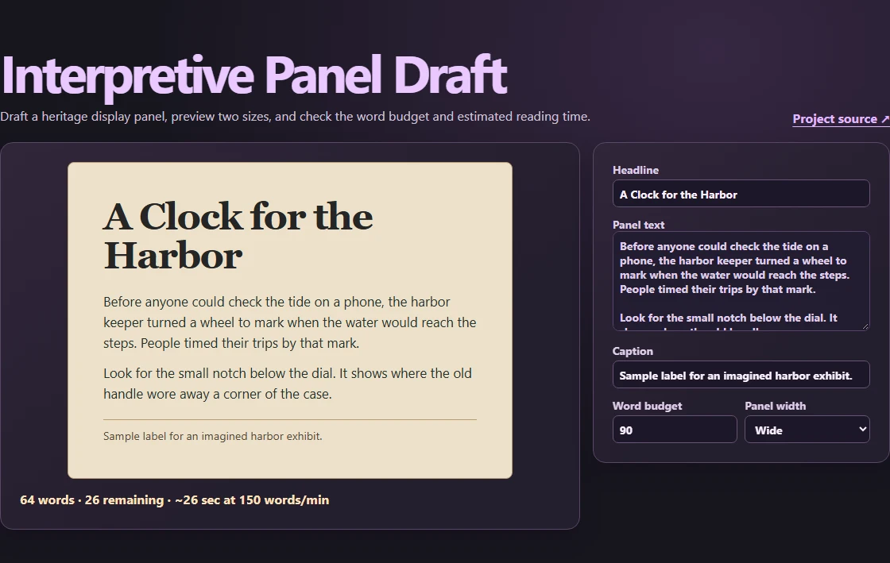

# Interpretive Panel Draft

Draft a heritage display panel, preview two sizes, and check the word budget and estimated reading time.

[Open the browser app](https://surfingcoder.com/apps/interpretive-panel-draft/)

## Run locally

Run the following command in this repository and open [localhost:8000](http://localhost:8000).

    python -m http.server 8000

Edit the sample text to draft your own panel. The count includes the headline, paragraphs and caption. The reading-time estimate uses 150 words per minute and the two panel widths give a quick way to compare line wrapping.

## Verify

Run the following command with Node.js 22 or newer.

    node --test
